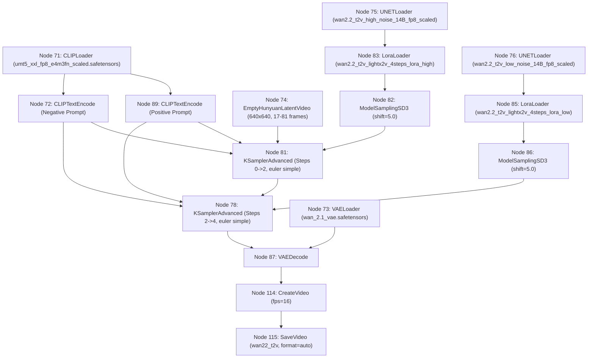

# ComfyUI Wan 2.1 / 2.2 Video Generation Integration

Local AI video generation integration connecting frontier and local coding agents (Antigravity, Bionic, Cursor) to a live local ComfyUI instance hosting the Wan 2.1 / 2.2 model family.

## Architecture & Endpoints

- **ComfyUI Server**: `http://127.0.0.1:8188`
- **REST Endpoints**:
  - `GET /object_info`: Introspect node definitions, input constraints, and output types.
  - `GET /queue`: Check active and pending execution queues.
  - `POST /prompt`: Submit API prompt graphs for execution. Returns `{prompt_id, number, node_errors}`.
  - `GET /history/{prompt_id}`: Retrieve completed node execution outputs and status.
  - `GET /view`: Download generated media assets (`/view?filename=...&subfolder=...&type=output`).
- **WebSocket Endpoint**:
  - `GET /ws?clientId={client_id}`: Real-time event stream (`execution_start`, `executing`, `progress`, `execution_success`, `execution_error`).

## Workflow Mapping (Wan 2.2 T2V 4-Step)

Derived from template `D:\Code\wan22\ComfyUI_windows_portable\ComfyUI\user\default\workflows\ComfyUI_Wan22_T2V.json`:



## Quick Start & Verification

### 1. Test Client Script (`scripts/tools/test_comfy_video.py`)

Submit a video generation prompt, stream progress over WebSocket, and download the resulting MP4:

```powershell
# Probe queue status
python scripts/tools/test_comfy_video.py --status

# Generate a 17-frame test preview (~1s at 16fps)
python scripts/tools/test_comfy_video.py --prompt "A glowing blue futuristic digital cube rotating slowly on a dark reflective surface, 4k, cinematic" --length 17

# Generate full 81-frame video (~5s at 16fps)
python scripts/tools/test_comfy_video.py --prompt "Cinematic drone shot of misty mountain peaks at sunrise, 4k" --length 81 --output-dir results/video
```

### 2. Harness CLI Integration (`harness video`)

Unified control plane command built into `scripts/cli/harness.py`:

```powershell
# Check queue and running tasks
python scripts/cli/harness.py video status

# Inspect installed Wan models, LoRAs, and VAEs
python scripts/cli/harness.py video models

# Trigger generation (blocking with live progress)
python scripts/cli/harness.py video generate --prompt "Cyberpunk city alley with neon signs in rain, 4k" --length 17

# Trigger generation asynchronously (non-blocking queue submission)
python scripts/cli/harness.py video generate --prompt "Floating crystal sphere refracting light" --no-wait
```

### 3. Agent Tool Calling via MCP Stdio Server

The MCP server runs over stdio (`scripts/tools/comfy_video_mcp_server.py`), exposing three tools:
- `video_generate`: Create text-to-video with customizable prompt, dimensions, length, steps, and blocking/async mode.
- `video_status`: Probe the queue and inspect specific prompt execution states.
- `video_list_models`: List installed diffusion checkpoints, LoRAs, and VAEs.

#### Antigravity Configuration (`~/.gemini/config/mcp_config.json`)
```json
{
  "mcpServers": {
    "comfy-video": {
      "command": "python",
      "args": ["c:/Code/KA/ai-router/scripts/tools/comfy_video_mcp_server.py"]
    }
  }
}
```

#### Cursor Configuration (`.cursor/mcp.json`)
```json
{
  "mcpServers": {
    "comfy-video": {
      "command": "python",
      "args": ["c:/Code/KA/ai-router/scripts/tools/comfy_video_mcp_server.py"]
    }
  }
}
```

#### Bionic Configuration
Add stdio server:
```json
{
  "name": "comfy-video",
  "command": "python",
  "args": ["c:/Code/KA/ai-router/scripts/tools/comfy_video_mcp_server.py"]
}
```
